# World Happiness AI Lab — Project Report

*Generated automatically by `python -m src.report` on 2026-11-25 01:24 UTC from the data in `data/raw` and the experiment results in `outputs/reports/experiment_results.json` (training run 2026-11-14T06:33:05 UTC). Every number below is computed, not typed.*

> **Interpretation note.** Life Ladder scores are national averages of *reported* life evaluations (Cantril ladder, 0–10). All relationships reported here are statistical associations in observational country-level data and must not be read as causal effects.

## 1. Executive summary

- **Data:** 2,199 country-year observations for 165 countries (2005–2022) from the WHR 2023 annual panel, plus official WHR ranking tables for 14 ranking years up to **WHR 2026** (survey years 2023–2025, 147 countries).
- **Latest ranking:** highest Finland (7.764), lowest Afghanistan (1.446); mean of countries 5.65.
- **Strongest correlate:** Log GDP per capita (PPP) (r = 0.78, n = 2179). The six WHR indicators jointly explain R² = 0.75 of the variance in Life Ladder in a pooled OLS regression (n = 1962).
- **Best model:** Random Forest, selected on validation RMSE for unseen countries: test RMSE **0.521**, MAE 0.395, R² 0.731 on 25 countries never seen in training (naive baselines: training mean 1.011, region mean 0.687).
- **Validation matters:** random K-fold CV understates error for new countries by 8% on average across models.
- **Uncertainty:** a split-conformal 90% interval of ±0.88 ladder points (calibrated on validation countries) covered 91.7% of rows from unseen test countries. The app recalibrates on all data (fixed width ±0.94, or the adaptive interval described in 6.5).
- **Clusters:** 3 country profiles (silhouette 0.33) — C1 Very high indicators · low perceived corruption, higher income, longer healthy lives; C2 Mid-range indicators · close to global average; C3 Low indicators · shorter healthy lives, weaker social support, lower income.

## 2. Data sources and preparation

| Dataset | Role | Rows | Countries | Years |
|---|---|---|---|---|
| `kaggle_unsdsn/2015.csv` | edition contrib | 158 | 158 | 2014–2014 |
| `kaggle_unsdsn/2016.csv` | edition contrib | 157 | 157 | 2015–2015 |
| `kaggle_unsdsn/2017.csv` | edition contrib | 155 | 155 | 2016–2016 |
| `kaggle_unsdsn/2018.csv` | edition contrib | 156 | 156 | 2017–2017 |
| `kaggle_unsdsn/2019.csv` | edition contrib | 156 | 156 | 2018–2018 |
| `whr_official/WHR20_Data_Figure_2.1.xls` | edition raw | 153 | 153 | 2019–2019 |
| `whr_official/WHR21_Data_Figure_2.1.xls` | edition raw | 149 | 149 | 2020–2020 |
| `whr_official/WHR22_Data_Figure_2.1.xls` | edition contrib | 146 | 146 | 2021–2021 |
| `whr_official/WHR23_Data_Figure_2.1.xls` | edition raw | 137 | 137 | 2022–2022 |
| `whr_official/WHR24_Data_Figure_2.1.xls` | edition contrib | 143 | 143 | 2023–2023 |
| `whr_official/WHR25_Data_Figure_2.1v3.xlsx` | ranking panel | 1969 | 167 | 2011–2024 |
| `whr_official/WHR26_Data_Figure_2.1.xlsx` | rankings | 2116 | 167 | 2011–2025 |
| `whr_panel/WHR2023_DataForTable2.1_panel.csv` | primary panel | 2199 | 165 | 2005–2022 |

Sources: official *Data for Figure 2.1* files from <https://worldhappiness.report/data-sharing/> (WHR 2020–2026); the WHR 2023 *DataForTable2.1* annual panel (obtained from a public Hugging Face mirror because the original link returns HTTP 403); and the Kaggle *unsdsn/world-happiness* 2015–2019 files (CC0). Checksums and methodology notes are stored in `data/raw/sources_manifest.json`.

**Panel verification (passed):** the panel's 2020–2022 means reproduce the official WHR 2023 ladder scores for 137/137 countries (Pearson r = 0.999933, median |Δ| = 0.0004).

**Cleaning:** headers mapped to a canonical schema across 7 structural variants; country names standardised (e.g. *Turkey/Turkiye/Türkiye*, `*`-flagged names in WHR 2022); definitionally impossible values set to missing (not clipped); genuine duplicates removed (none found in the panel). Values invalidated:
  - healthy_life_expectancy = 6.720 for Haiti 2006 is outside the plausible range [20.0, 90.0] → set to missing.
  - healthy_life_expectancy = 17.360 for Haiti 2008 is outside the plausible range [20.0, 90.0] → set to missing.

**Missing data:** 351 indicator cells (1.8%) are missing; the Life Ladder target is complete. Strategies compared (country-grouped 5-fold CV RMSE of a Ridge model):

| strategy | rows_used | rows_lost | countries_used | cells_filled_outside_pipeline | mean_shift_sd | grouped_cv_rmse |
|---|---|---|---|---|---|---|
| Complete cases only (drop rows) | 1962 | 237 | 156 | 0 | 0.0187 | 0.5906 |
| Median (fitted in pipeline) | 2199 | 0 | 165 | 0 | 0.0000 | 0.5878 |
| Mean (fitted in pipeline) | 2199 | 0 | 165 | 0 | 0.0000 | 0.5879 |
| Country interpolation + median | 2199 | 0 | 165 | 75 | 0.0012 | 0.5881 |
| Country past-only carry-forward + median | 2199 | 0 | 165 | 168 | 0.0078 | 0.5865 |

Median imputation inside the pipeline was retained: it keeps all 2199 rows and 165 countries and performs on par with alternatives.

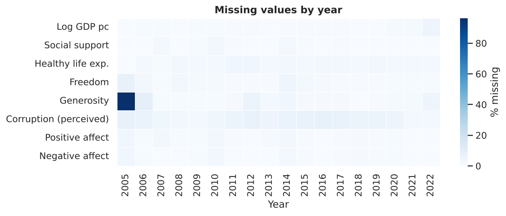

## 3. Exploratory analysis

Life Ladder across all country-years: mean 5.48, median 5.43, SD 1.13, skewness -0.02, range 1.28 (Afghanistan 2022) to 8.02 (Denmark 2005).

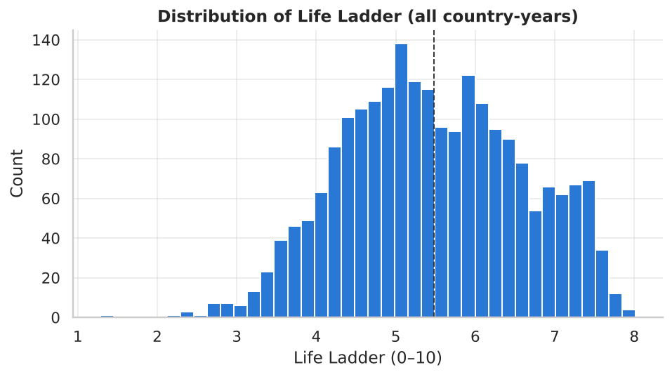

**Top 10 — WHR 2026 (3-year averages 2023–2025):**

| rank | country | ladder_score | lower_whisker | upper_whisker |
|---|---|---|---|---|
| 1 | Finland | 7.764 | 7.690 | 7.837 |
| 2 | Iceland | 7.540 | 7.449 | 7.630 |
| 3 | Denmark | 7.539 | 7.446 | 7.631 |
| 4 | Costa Rica | 7.439 | 7.356 | 7.522 |
| 5 | Sweden | 7.255 | 7.172 | 7.337 |
| 6 | Norway | 7.242 | 7.156 | 7.327 |
| 7 | Netherlands | 7.223 | 7.153 | 7.293 |
| 8 | Israel | 7.187 | 7.119 | 7.254 |
| 9 | Luxembourg | 7.063 | 6.971 | 7.154 |
| 10 | Switzerland | 7.018 | 6.937 | 7.099 |

**Bottom 10 — WHR 2026:**

| rank | country | ladder_score | lower_whisker | upper_whisker |
|---|---|---|---|---|
| 147 | Afghanistan | 1.446 | 1.348 | 1.544 |
| 146 | Sierra Leone | 3.251 | 3.147 | 3.355 |
| 145 | Malawi | 3.284 | 3.153 | 3.415 |
| 144 | Zimbabwe | 3.346 | 3.244 | 3.449 |
| 143 | Botswana | 3.464 | 3.335 | 3.593 |
| 142 | Yemen | 3.532 | 3.306 | 3.758 |
| 141 | Lebanon | 3.723 | 3.635 | 3.811 |
| 140 | Congo (Kinshasa) | 3.761 | 3.609 | 3.914 |
| 139 | Egypt | 3.862 | 3.765 | 3.958 |
| 138 | Tanzania | 3.902 | 3.763 | 4.041 |

Largest change between WHR 2012 and WHR 2026 (141 countries in both): improvement — Serbia (+2.13), Bulgaria (+1.81), Georgia (+1.63), Latvia (+1.60), Bosnia and Herzegovina (+1.52); decline — Afghanistan (-2.81), Malawi (-1.34), Lebanon (-1.33), Jordan (-1.23), Venezuela (-1.17).

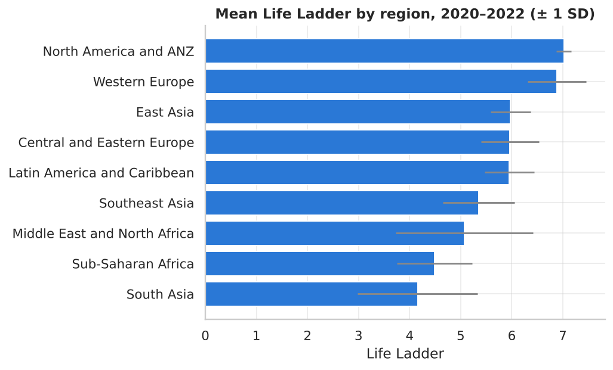

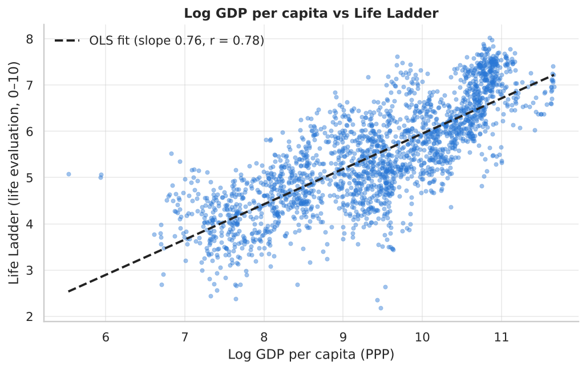

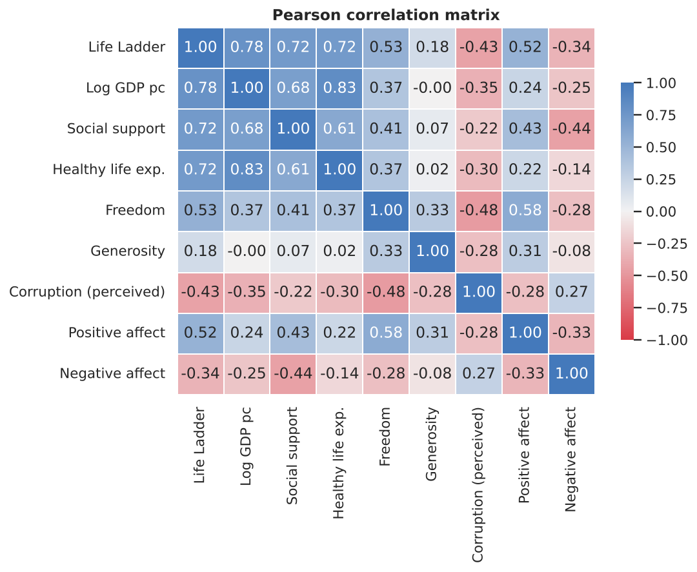

## 4. Statistical findings

### 4.1 Correlation tests (pairwise-complete country-years; Holm-adjusted p)

| feature | n | pearson_r | pearson_ci_low | pearson_ci_high | pearson_p_holm | spearman_rho | strength |
|---|---|---|---|---|---|---|---|
| Log GDP per capita (PPP) | 2179 | 0.785 | 0.768 | 0.800 | < 1e-300 | 0.804 | strong |
| Healthy life expectancy (years) | 2143 | 0.723 | 0.702 | 0.743 | < 1e-300 | 0.765 | strong |
| Social support | 2186 | 0.722 | 0.701 | 0.741 | < 1e-300 | 0.762 | strong |
| Freedom to make life choices | 2166 | 0.534 | 0.504 | 0.564 | 1.30e-159 | 0.545 | moderate–strong |
| Positive affect | 2175 | 0.518 | 0.487 | 0.548 | 3.89e-149 | 0.514 | moderate–strong |
| Perceptions of corruption | 2083 | -0.431 | -0.466 | -0.396 | 9.60e-95 | -0.327 | moderate |
| Negative affect | 2183 | -0.340 | -0.377 | -0.302 | 6.80e-60 | -0.298 | moderate |
| Generosity (residual) | 2126 | 0.182 | 0.140 | 0.222 | 3.17e-17 | 0.163 | weak |

Because countries contribute many years, observations are not independent and these p-values are optimistic; the clustered regression below is more conservative.

### 4.2 Multiple linear regression (OLS, n = 1962, 156 countries)

R² = 0.753, adjusted R² = 0.752, F = 993.7 (p < 1e-300).

| term | coef | std_err | ci_low | ci_high | p_value | cluster_std_err | cluster_p_value | beta |
|---|---|---|---|---|---|---|---|---|
| const | -2.0454 | 0.1691 | -2.3770 | -1.7137 | 1.57e-32 | 0.4940 | 3.47e-05 |  |
| Log GDP per capita (PPP) | 0.3543 | 0.0236 | 0.3080 | 0.4006 | 3.28e-48 | 0.0684 | 2.21e-07 | 0.3598 |
| Social support | 2.5819 | 0.1501 | 2.2875 | 2.8763 | 7.37e-62 | 0.3511 | 1.92e-13 | 0.2798 |
| Healthy life expectancy (years) | 0.0279 | 0.0035 | 0.0210 | 0.0349 | 3.97e-15 | 0.0105 | 0.0079 | 0.1684 |
| Freedom to make life choices | 1.1858 | 0.1148 | 0.9606 | 1.4110 | 2.26e-24 | 0.2753 | 1.66e-05 | 0.1459 |
| Generosity (residual) | 0.5568 | 0.0867 | 0.3867 | 0.7268 | 1.69e-10 | 0.2517 | 0.0270 | 0.0789 |
| Perceptions of corruption | -0.7255 | 0.0834 | -0.8890 | -0.5619 | 6.89e-18 | 0.2571 | 0.0048 | -0.1177 |

*cluster_* columns use standard errors clustered by country; *beta* = standardised coefficient.*

**Assumption checks:**

- Breusch–Pagan p = 1.94e-17: evidence of heteroscedasticity → rely on HC3 / clustered SEs.
- Jarque–Bera p = 1.72e-10: residuals deviate from normality (with large n, inference on coefficients remains approximately valid).
- Durbin–Watson = 0.59: positive autocorrelation, expected because rows are sorted country-year → clustered SEs account for within-country dependence.
- Max VIF = 4.56: multicollinearity is moderate.
- Ramsey RESET p = 8.7e-30: some evidence of non-linearity / omitted terms.

VIF: Log GDP pc 4.56, Social support 2.10, Healthy life exp. 3.58, Freedom 1.58, Generosity 1.19, Corruption (perceived) 1.45

### 4.3 Regional differences (one mean per country, 2020–2022, 137 countries)

One-way ANOVA F = 28.81 (p 3.1e-25); Welch ANOVA F = 58.83 (p 3.4e-17); Kruskal–Wallis H = 92.03 (p 1.8e-16); Levene p = 0.015. Effect size η² = 0.64 (ω² = 0.62). 16 of 36 region pairs differ after Holm correction (Mann–Whitney). η² = 0.64: group membership accounts for 64% of the variance in country scores — a large effect by Cohen's benchmarks.

| region | count | mean | median | std |
|---|---|---|---|---|
| North America and ANZ | 4 | 7.018 | 7.028 | 0.109 |
| Western Europe | 20 | 6.894 | 6.901 | 0.558 |
| Latin America and Caribbean | 19 | 5.967 | 6.023 | 0.382 |
| Central and Eastern Europe | 26 | 5.946 | 6.028 | 0.530 |
| East Asia | 6 | 5.930 | 5.896 | 0.403 |
| Southeast Asia | 9 | 5.431 | 5.522 | 0.732 |
| Middle East and North Africa | 14 | 5.108 | 4.908 | 1.271 |
| Sub-Saharan Africa | 33 | 4.383 | 4.433 | 0.677 |
| South Asia | 6 | 4.065 | 4.355 | 1.183 |

## 5. Feature engineering

Engineered variables (documented in `src/feature_engineering.py`): year, WHR region (one-hot), backward-looking GDP growth (Δ log GDP vs the previous observed year), a composite z-score index (optional transformer), quartile categories for EDA, and target-derived descriptive variables (year-over-year ladder change, ladder-vs-GDP residual, happiness band) that are blocked from model inputs. Cross-validated RMSE before/after feature engineering:

| model | strategy | core | core_plus_affect | engineered |
|---|---|---|---|---|
| Random Forest | group | 0.5650 | 0.5331 | 0.5448 |
| Random Forest | temporal | 0.5269 | 0.4986 | 0.5149 |
| Ridge Regression | group | 0.5874 | 0.5547 | 0.5651 |
| Ridge Regression | temporal | 0.5603 | 0.5299 | 0.5464 |
| XGBoost | group | 0.5627 | 0.5265 | 0.5385 |
| XGBoost | temporal | 0.5213 | 0.4905 | 0.5018 |

## 6. Machine learning

### 6.1 Validation methodology

- **Random split** — train 1539 rows (162 countries, 2005–2022), validation 330 (2005–2022), test 330 (133 countries, 2005–2022); countries in both train and test: 132.
- **Unseen countries (grouped)** — train 1577 rows (115 countries, 2005–2022), validation 319 (2005–2022), test 303 (25 countries, 2005–2022); countries in both train and test: 0.
- **Future years (time-aware)** — train 1416 rows (163 countries, 2005–2016), validation 288 (2017–2018), test 495 (146 countries, 2019–2022); countries in both train and test: 145.

Hyper-parameters were tuned with RandomizedSearchCV (scoring = RMSE), 20 iterations per model, using K-fold, GroupKFold or forward-year CV on the training portion only, matching each question. All preprocessing (median imputation, scaling, one-hot encoding) is inside the pipeline.

### 6.2 Results

**Random split**

| model | val_rmse | test_rmse | test_mae | test_r2 | cv_rmse | train_rmse | tuned |
|---|---|---|---|---|---|---|---|
| XGBoost | 0.4556 | 0.4891 | 0.3701 | 0.8072 | 0.4563 | 0.1981 | True |
| Random Forest | 0.4582 | 0.4881 | 0.3618 | 0.8080 | 0.4531 | 0.1643 | True |
| Gradient Boosting | 0.4595 | 0.5034 | 0.3820 | 0.7958 | 0.4580 | 0.2459 | True |
| Ridge Regression | 0.5654 | 0.6058 | 0.4622 | 0.7042 | 0.5671 | 0.5637 | True |
| Lasso Regression | 0.5657 | 0.6064 | 0.4620 | 0.7036 | 0.5672 | 0.5637 | True |
| Linear Regression | 0.5657 | 0.6064 | 0.4620 | 0.7036 | 0.5672 | 0.5637 | False |
| Decision Tree | 0.5793 | 0.5702 | 0.4311 | 0.7380 | 0.5472 | 0.4443 | True |

**Unseen countries (grouped)**

| model | val_rmse | test_rmse | test_mae | test_r2 | cv_rmse | train_rmse | tuned |
|---|---|---|---|---|---|---|---|
| Random Forest | 0.5165 | 0.5208 | 0.3947 | 0.7311 | 0.5910 | 0.4540 | True |
| XGBoost | 0.5208 | 0.5171 | 0.3870 | 0.7349 | 0.5918 | 0.4565 | True |
| Gradient Boosting | 0.5255 | 0.5370 | 0.4040 | 0.7141 | 0.5996 | 0.4722 | True |
| Lasso Regression | 0.5718 | 0.5731 | 0.4343 | 0.6744 | 0.5861 | 0.5736 | True |
| Linear Regression | 0.5718 | 0.5730 | 0.4343 | 0.6744 | 0.5861 | 0.5736 | False |
| Ridge Regression | 0.5727 | 0.5712 | 0.4341 | 0.6765 | 0.5858 | 0.5737 | True |
| Decision Tree | 0.6170 | 0.6363 | 0.4831 | 0.5986 | 0.6606 | 0.4988 | True |

**Future years (time-aware)**

| model | val_rmse | test_rmse | test_mae | test_r2 | cv_rmse | train_rmse | tuned |
|---|---|---|---|---|---|---|---|
| Random Forest | 0.4929 | 0.5679 | 0.4317 | 0.7463 | 0.4702 | 0.1997 | True |
| Gradient Boosting | 0.4951 | 0.5778 | 0.4472 | 0.7373 | 0.4919 | 0.2534 | True |
| XGBoost | 0.5034 | 0.5689 | 0.4326 | 0.7454 | 0.4886 | 0.1937 | True |
| Ridge Regression | 0.5864 | 0.5640 | 0.4267 | 0.7498 | 0.5786 | 0.5722 | True |
| Linear Regression | 0.5866 | 0.5641 | 0.4268 | 0.7497 | 0.5786 | 0.5722 | False |
| Lasso Regression | 0.5866 | 0.5641 | 0.4268 | 0.7497 | 0.5786 | 0.5722 | True |
| Decision Tree | 0.6089 | 0.6575 | 0.5083 | 0.6599 | 0.5601 | 0.4578 | True |

**Naive baselines** (no indicators used; fitted on the training rows of each split, scored on the same validation/test rows):

| question | baseline | val_rmse | test_rmse | test_mae | test_r2 | best_model_test_rmse |
|---|---|---|---|---|---|---|
| Random split | Training mean | 1.0818 | 1.1147 | 0.9272 | -0.0014 | 0.4881 |
| Random split | Region mean (training rows) | 0.7117 | 0.7190 | 0.5581 | 0.5834 | 0.4881 |
| Unseen countries (grouped) | Training mean | 1.2098 | 1.0114 | 0.8257 | -0.0142 | 0.5208 |
| Unseen countries (grouped) | Region mean (training rows) | 0.8763 | 0.6869 | 0.5358 | 0.5321 | 0.5208 |
| Future years (time-aware) | Training mean | 1.1124 | 1.1450 | 0.9371 | -0.0313 | 0.5679 |
| Future years (time-aware) | Region mean (training rows) | 0.7410 | 0.7965 | 0.6199 | 0.5009 | 0.5679 |

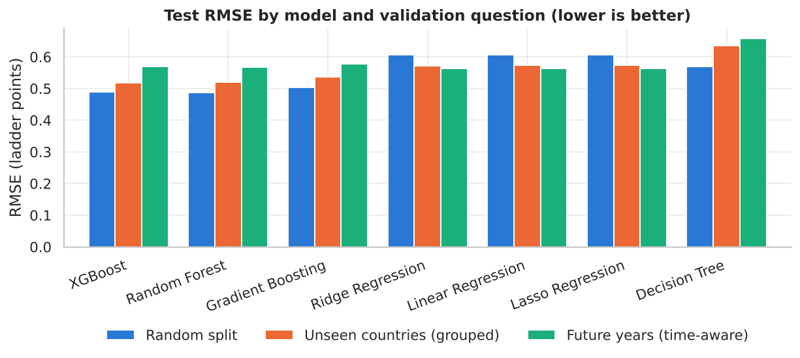

### 6.3 Cross-validation strategy comparison (same model, same data)

| model | random | group | temporal | group_vs_random_% |
|---|---|---|---|---|
| Decision Tree | 0.5636 | 0.6503 | 0.5895 | 15.3745 |
| Gradient Boosting | 0.5174 | 0.5644 | 0.5246 | 9.0795 |
| Lasso Regression | 0.5719 | 0.5878 | 0.5604 | 2.7909 |
| Linear Regression | 0.5719 | 0.5878 | 0.5604 | 2.7906 |
| Random Forest | 0.5058 | 0.5650 | 0.5269 | 11.7125 |
| Ridge Regression | 0.5719 | 0.5874 | 0.5603 | 2.7217 |
| XGBoost | 0.5074 | 0.5627 | 0.5213 | 10.8899 |

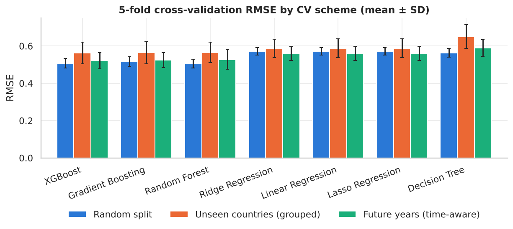

### 6.4 Selected model

**Random Forest** — Lowest validation RMSE on held-out countries (country-grouped split); MAE as tie-breaker. R² is reported but not used alone. Tuned parameters: `{'n_estimators': 400, 'max_depth': 6, 'min_samples_leaf': 4, 'max_features': 0.4, 'min_samples_split': 20}`.

| Question | Test RMSE | 95% CI (country bootstrap) | Test MAE | Test R² |
|---|---|---|---|---|
| Random split | 0.488 | 0.431–0.552 | 0.362 | 0.808 |
| Unseen countries (grouped) | 0.521 | 0.400–0.650 | 0.395 | 0.731 |
| Future years (time-aware) | 0.568 | 0.499–0.641 | 0.432 | 0.746 |

Intervals come from resampling whole test countries (25 on the unseen-country split, 2000 resamples), because rows of one country are not independent. 95% interval of the RMSE difference on unseen countries (Random Forest minus other): vs XGBoost -0.028 to +0.037; vs Ridge Regression -0.120 to +0.015 ladder points; an interval that contains 0 means this test set cannot tell the two models apart.

Prediction intervals: Split-conformal (country-grouped); half-width ±0.876 calibrated on 319 validation rows gives 91.7% coverage on 303 unseen test rows (target 90%). The production fixed-width interval uses ±0.937, the 90% quantile of grouped 5-fold out-of-fold residuals on all data (its coverage on those same residuals is 90% by construction, so it is not a separate test).

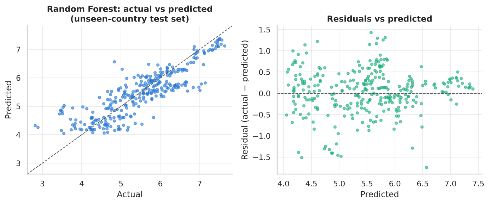

### 6.5 Extreme scores and adaptive intervals

Out-of-fold (country-grouped) error of the selected model by *actual* score band. Positive bias = under-prediction:

| actual_band | n | bias_actual_minus_pred | mae | rmse | bias_with_affect | rmse_with_affect |
|---|---|---|---|---|---|---|
| < 4 (very low) | 204 | -0.776 | 0.781 | 0.909 | -0.748 | 0.864 |
| 4–5 | 584 | -0.172 | 0.385 | 0.492 | -0.152 | 0.473 |
| 5–6 | 673 | 0.039 | 0.384 | 0.497 | 0.070 | 0.478 |
| 6–7 | 487 | 0.269 | 0.421 | 0.544 | 0.222 | 0.486 |
| ≥ 7 (very high) | 251 | 0.415 | 0.437 | 0.593 | 0.393 | 0.560 |

Like any imperfect predictor, the model shrinks extremes; much of the remaining error plausibly comes from information the indicators do not contain (conflict, collapse). Post-hoc fixes such as recalibration or stacking are not part of this pipeline. Two remedies are deployed: (1) a **normalised conformal interval** whose width follows a learned difficulty model (half-width ±0.29 to ±2.14). On the out-of-fold rows used to calibrate it, overall coverage is 90.0% by construction, and 75% for actual scores below 4 (fixed-width: 68%); (2) an optional companion model adding positive/negative affect (grouped out-of-fold RMSE 0.535 vs 0.568).

**Held-out check of the intervals.** Refitting the whole interval procedure on the train + validation countries only and scoring the 303 rows of the 25 unseen test countries: adaptive coverage 92.7% overall, 57% for actual scores below 4 and 68% for scores ≥ 7; fixed-width (±0.97) 91.7%, 52% and 88%. The test set holds only 21 rows below 4 (from 5 countries) and 25 rows ≥ 7, so the band-level figures are rough; in both checks the intervals under-cover very unhappy country-years.

## 7. Explainable AI

Measured for the evaluation Random Forest on the unseen-country test set (303 rows):

| feature | importance_mean | importance_std | mean_abs_shap |
|---|---|---|---|
| Log GDP per capita (PPP) | 0.1980 | 0.0226 | 0.3089 |
| Healthy life expectancy (years) | 0.1370 | 0.0183 | 0.1896 |
| Social support | 0.1359 | 0.0159 | 0.2043 |
| Freedom to make life choices | 0.0483 | 0.0084 | 0.0903 |
| Perceptions of corruption | 0.0179 | 0.0037 | 0.0490 |
| Generosity (residual) | 0.0079 | 0.0018 | 0.0213 |

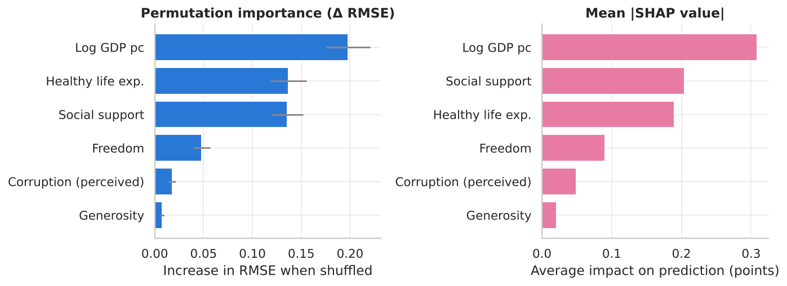

Importance is model-dependent: income, healthy life expectancy and social support are strongly inter-correlated (see VIFs), so the model can substitute one for another. These rankings describe what the model uses to reproduce historical patterns, not causal effects.

## 8. Clustering

Country profiles = mean of the six indicators over 2020, 2021, 2022 (134 countries; excluded for incomplete data: China, Hong Kong S.A.R. of China, Kosovo). Standardised features; K-means (n_init = 50) and Ward hierarchical clustering.

| k | wcss | silhouette | davies_bouldin | calinski_harabasz | min_cluster_size |
|---|---|---|---|---|---|
| 2 | 504.995 | 0.340 | 1.178 | 78.156 | 50 |
| 3 | 373.931 | 0.331 | 1.066 | 75.334 | 22 |
| 4 | 316.032 | 0.314 | 1.130 | 66.909 | 18 |
| 5 | 272.096 | 0.309 | 1.173 | 63.044 | 15 |
| 6 | 246.889 | 0.297 | 1.168 | 57.767 | 14 |
| 7 | 229.746 | 0.258 | 1.209 | 52.907 | 3 |
| 8 | 214.127 | 0.268 | 1.234 | 49.586 | 4 |

k = 3 has the best average rank across silhouette (↑), Davies–Bouldin (↓) and Calinski–Harabasz (↑) among solutions whose smallest cluster has ≥ 5 countries. Silhouette = 0.331, Davies–Bouldin = 1.066; agreement with Ward clustering ARI = 0.68. PC1 and PC2 explain 53% and 20% of the variance.

| cluster | name | n_countries | Log GDP pc | Social support | Healthy life exp. | Freedom | Generosity | Corruption (perceived) | Life Ladder* | example_countries |
|---|---|---|---|---|---|---|---|---|---|---|
| C1 | Very high indicators · low perceived corruption, higher income, longer healthy lives | 22 | 10.953 | 0.913 | 70.648 | 0.897 | 0.093 | 0.383 | 7.010 | Finland, Denmark, Iceland, Netherlands, Sweden |
| C2 | Mid-range indicators · close to global average | 70 | 9.781 | 0.854 | 67.052 | 0.802 | -0.021 | 0.791 | 5.812 | Israel, United States, Czechia, Lithuania, Slovenia |
| C3 | Low indicators · shorter healthy lives, weaker social support, lower income | 42 | 8.071 | 0.642 | 58.071 | 0.705 | 0.056 | 0.783 | 4.294 | Nepal, Congo (Brazzaville), Venezuela, Laos, Guinea |

\* Life Ladder was not used to form clusters; it is shown only to describe them. Names are generated from each cluster's own z-score profile.

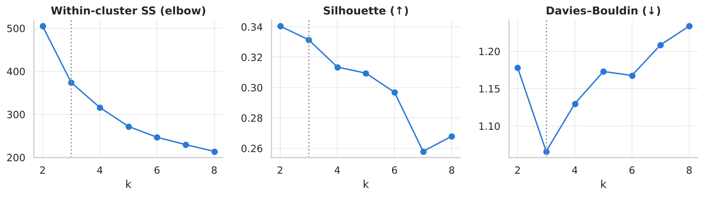

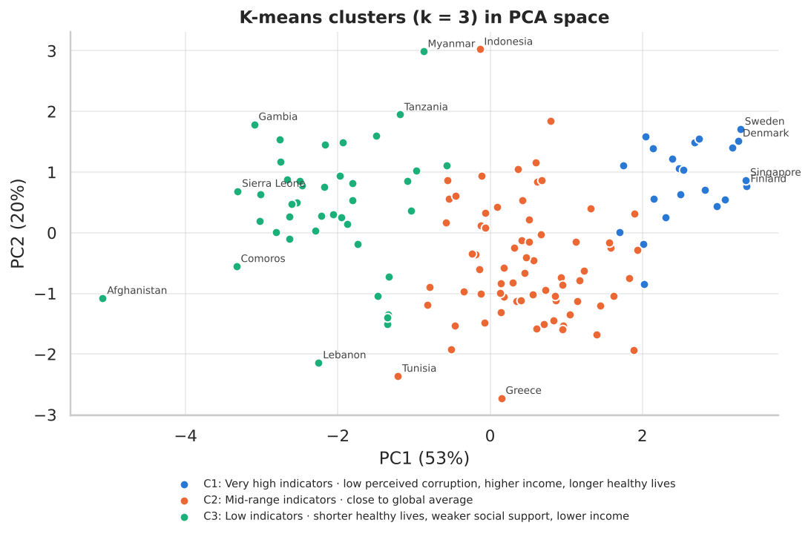

## 9. Automated insights

- **Highest reported life evaluations** (Rankings; Ladder score (3-yr avg) = 7.764; source `WHR26_Data_Figure_2.1.xlsx`; 2023–2025): In the WHR 2026 ranking (survey years 2023–2025), the highest 3-year average ladder scores are: Finland (7.764), Iceland (7.540), Denmark (7.539) — out of 147 countries ranked.
- **Lowest reported life evaluations** (Rankings; Ladder score (3-yr avg) = 1.446; source `WHR26_Data_Figure_2.1.xlsx`; 2023–2025): The lowest scores in the same ranking are: Afghanistan (1.446), Sierra Leone (3.251), Malawi (3.284). The gap between first and last place is 6.32 points on the 0–10 ladder.
- **Ranking uncertainty at the top** (Rankings; Countries with overlapping CI = 0; source `WHR26_Data_Figure_2.1.xlsx`; 2023–2025): No other country's 95% confidence interval overlaps with Finland's (7.690–7.837), so its first place is statistically distinguishable; further down the table most neighbouring ranks have overlapping intervals (143 of 146 adjacent pairs).
- **Largest long-run improvement** (Change over time; Δ ladder score = +2.13; source `WHR26_Data_Figure_2.1.xlsx`; 2011→2025): Among 141 countries ranked in both WHR 2012 and WHR 2026, Serbia improved the most: 4.56 → 6.69 (+2.13), moving +88 places.
- **Largest long-run decline** (Change over time; Δ ladder score = -2.81; source `WHR26_Data_Figure_2.1.xlsx`; 2011→2025): Afghanistan declined the most: 4.26 → 1.45 (-2.81), moving -16 places.
- **Largest single-year rise** (Change over time; Δ Life Ladder (1 yr) = +1.66; source `WHR2023_DataForTable2.1_panel.csv`; 2012→2013): Bahrain recorded the largest year-over-year increase in the annual panel: +1.66 points from 2012 to 2013. Single-year national survey means are noisy, so such jumps should be read with caution.
- **Largest single-year fall** (Change over time; Δ Life Ladder (1 yr) = -2.00; source `WHR2023_DataForTable2.1_panel.csv`; 2010→2011): El Salvador recorded the largest year-over-year fall: -2.00 points from 2010 to 2011.
- **Steadiest upward and downward trends** (Change over time; Trend slope (pts / yr) = +0.162; source `WHR2023_DataForTable2.1_panel.csv`; 2005–2022): Fitting a linear trend to each country with ≥ 8 annual observations, Guinea shows the steepest rise (+0.162 points/year, 2011–2022) and Afghanistan the steepest decline (-0.181 points/year, 2008–2022).
- **Strongest observed correlation** (Relationships; Pearson r = 0.78; source `WHR2023_DataForTable2.1_panel.csv`; 2005–2022): Across 2179 country-years, Log GDP pc has the strongest linear association with Life Ladder (Pearson r = 0.78, Spearman ρ = 0.80, p < 0.001). This is an association, not evidence of causation.
- **Weakest observed correlation** (Relationships; Pearson r = 0.18; source `WHR2023_DataForTable2.1_panel.csv`; 2005–2022): Generosity shows the weakest association (r = 0.18, n = 2126).
- **Negative association** (Relationships; Pearson r = -0.43; source `WHR2023_DataForTable2.1_panel.csv`; 2005–2022): Higher corruption (perceived) goes with lower life evaluations (r = -0.43).
- **Regional differences** (Regions; Regional gap (pts) = 2.95; source `WHR2023_DataForTable2.1_panel.csv`; 2020–2022): Using one average per country (2020–2022), North America and ANZ has the highest mean Life Ladder (7.02) and South Asia the lowest (4.06). Kruskal–Wallis p < 0.001; η² = 0.64 (region accounts for about 64% of between-country variance).
- **Life evaluations vs income** (Relationships; Residual vs GDP line = +1.46; source `WHR2023_DataForTable2.1_panel.csv`; 2022): In 2022, relative to a simple GDP-only line fitted to all country-years, Nicaragua reports life evaluations 1.46 points higher than its income alone would suggest, while Lebanon reports 3.16 points lower. Other factors matter beyond income.
- **Most incomplete indicator** (Data quality; Missing share = 5.3%; source `WHR2023_DataForTable2.1_panel.csv`; 2005–2022): Corruption (perceived) is missing in 5.3% of country-years; missing inputs are imputed inside the model pipeline (training-fold statistics only) and target scores are never imputed.
- **Best predictive model** (Machine learning; Test RMSE (unseen countries) = 0.521; source `outputs/reports/experiment_results.json`; 2026-11-14): Random Forest achieved the lowest validation RMSE on countries never seen in training (0.517 points); on a further held-out set of unseen countries its test RMSE is 0.521 (R² = 0.73).
- **Random splits are optimistic** (Machine learning; Optimism gap = +12%; source `outputs/reports/experiment_results.json`; 2026-11-14): For Random Forest, random K-fold CV gives RMSE 0.506, but country-grouped CV gives 0.565 (+12%). Random splits let the model see other years of the same country, overstating accuracy for new countries.
- **Most important predictor** (Machine learning; Δ RMSE when permuted = +0.198; source `Permutation importance (group test set)`): Shuffling Log GDP pc increases the best model's RMSE by 0.198 points on unseen countries — the largest permutation importance. Importance reflects the model's reliance, shared among correlated features, not causal effect.
- **3 country profiles** (Clusters; Silhouette score = 0.33; source `WHR2023_DataForTable2.1_panel.csv`; 2020, 2021, 2022): K-means on the six indicators (Life Ladder not used for clustering) finds: Very high indicators · low perceived corruption, higher income, longer healthy lives (22 countries, mean ladder 7.01; e.g. Finland, Denmark, Iceland, Netherlands, Sweden) | Mid-range indicators · close to global average (70 countries, mean ladder 5.81; e.g. Israel, United States, Czechia, Lithuania, Slovenia) | Low indicators · shorter healthy lives, weaker social support, lower income (42 countries, mean ladder 4.29; e.g. Nepal, Congo (Brazzaville), Venezuela, Laos, Guinea). Silhouette = 0.33, indicating moderately separated, overlapping groups rather than sharp categories.

## 10. Limitations

- Reported life evaluations may be shaped by cultural response styles; they are not objective measures of individual happiness.
- Observational data: confounding and reverse causality cannot be excluded; no result is causal.
- Repeated country observations are dependent; naïve p-values are anti-conservative (clustered SEs reported).
- National means rest on ~1,000 respondents per country-year; small changes are within sampling error.
- The annual panel ends in 2022; WHR 2024–2026 rankings are included but provide explained-by contributions, not raw indicators.
- Country coverage varies over time; some indicators (perceived corruption, healthy life expectancy) are missing for specific countries.
- Model-based what-if scenarios describe model behaviour, not the consequences of real-world interventions.
- Hyper-parameters tuned on the grouped split's training countries are reused in the all-data experiments (CV-scheme comparison, out-of-fold intervals), so those figures are slightly optimistic for the countries the tuning saw.
- 90% intervals hold on average, not for every country: coverage is clearly lower for very low actual scores (see 6.5).
