# 🌍 World Happiness AI Lab
### Understanding and Predicting Global Happiness

A complete, locally-running research platform for the **World Happiness Report** (WHR): data acquisition and validation,
exploratory analysis, formal statistics, feature engineering, seven regression models validated three different ways,
country clustering, explainable AI, an interactive world map, country comparison, happiness prediction with calibrated
intervals, a what-if scenario simulator and an automated insights engine — all in a premium dark-themed Streamlit app.

> **Important.** Happiness scores here are national averages of *reported* life evaluations (the Cantril ladder, 0–10),
> not an objective measurement of how happy every individual is. Every relationship the platform shows is a statistical
> **association** in observational country-level data; none is presented as a cause.

## Quick start
Needs **Python 3.12 or newer** (64-bit; CI tests 3.12 and 3.13). Python 3.11 will not work: the pinned numpy/SciPy/XGBoost/SHAP versions need 3.12+.
```bash
git clone https://github.com/aarushagrawal267-maker/world-happiness-ai-lab.git
cd world-happiness-ai-lab
python -m venv .venv
source .venv/bin/activate          # Windows: .venv\Scripts\activate
pip install -r requirements.txt
streamlit run app.py               # opens http://localhost:8501
python -m pytest -q                # optional: run the 109 automated tests
```
Datasets and trained models are already included, so the app works offline straight after installation.

## Screenshots
All 15 pages of the app, in navigation order. Click a thumbnail to open the full-size screenshot.

<table>
  <tr>
    <td align="center" valign="top" width="33%"><b>Home dashboard</b><br><a href="docs/screenshots/01_home.png">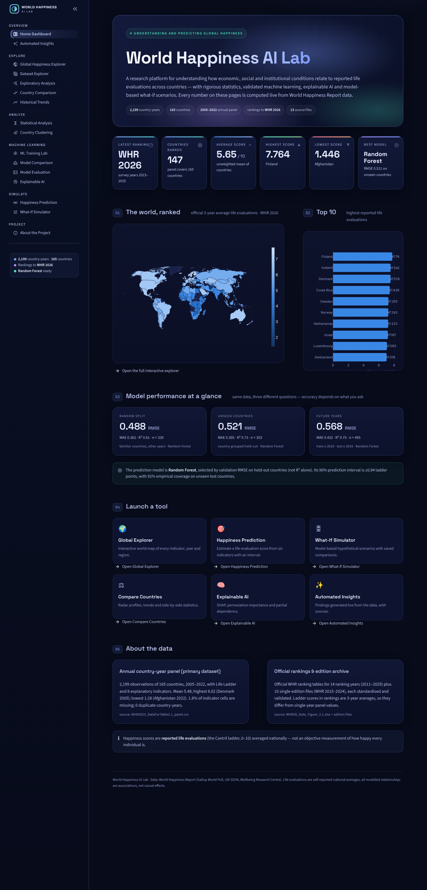</a></td>
    <td align="center" valign="top" width="33%"><b>Global happiness explorer</b><br><a href="docs/screenshots/02_Global_Happiness_Explorer.png">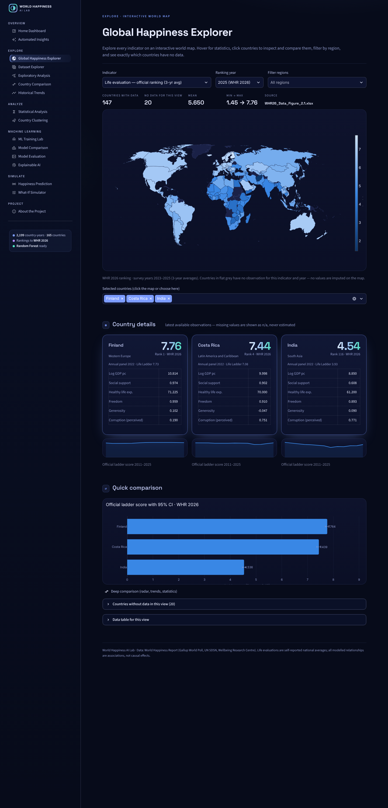</a></td>
    <td align="center" valign="top" width="33%"><b>Exploratory analysis</b><br><a href="docs/screenshots/03_Exploratory_Analysis.png">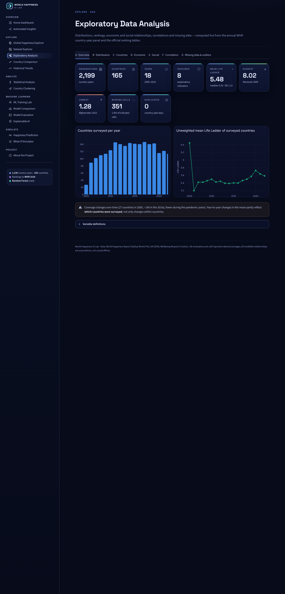</a></td>
  </tr>
  <tr>
    <td align="center" valign="top" width="33%"><b>Statistical analysis</b><br><a href="docs/screenshots/04_Statistical_Analysis.png">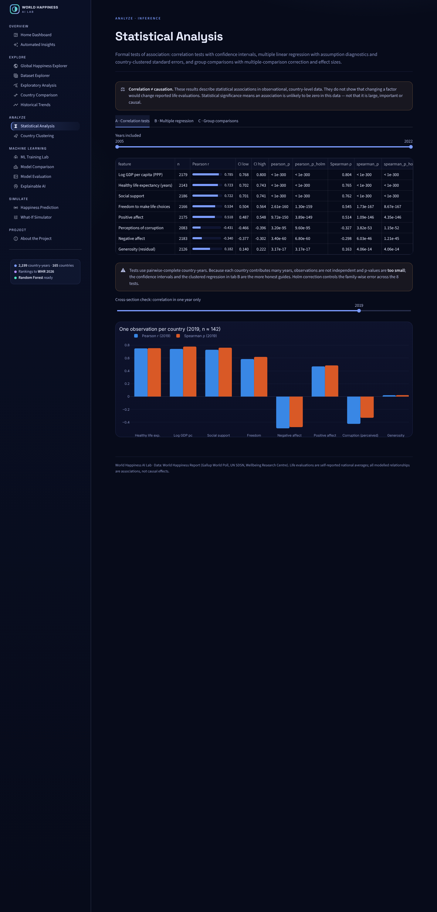</a></td>
    <td align="center" valign="top" width="33%"><b>Country comparison</b><br><a href="docs/screenshots/05_Country_Comparison.png">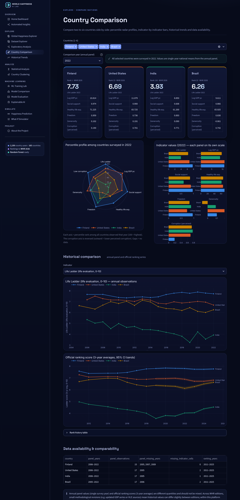</a></td>
    <td align="center" valign="top" width="33%"><b>Historical trends</b><br><a href="docs/screenshots/06_Historical_Trends.png">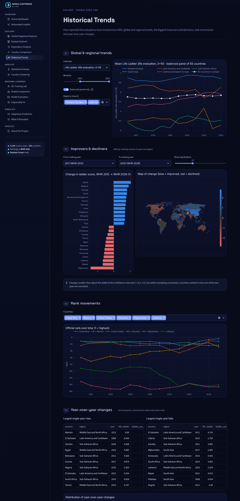</a></td>
  </tr>
  <tr>
    <td align="center" valign="top" width="33%"><b>Country clustering</b><br><a href="docs/screenshots/07_Country_Clustering.png">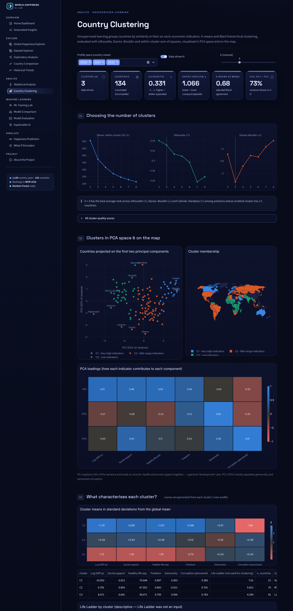</a></td>
    <td align="center" valign="top" width="33%"><b>Model comparison</b><br><a href="docs/screenshots/08_Model_Comparison.png">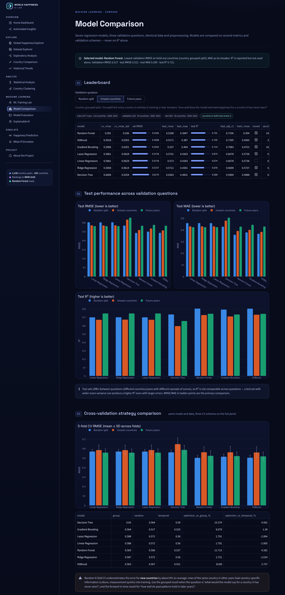</a></td>
    <td align="center" valign="top" width="33%"><b>Model evaluation</b><br><a href="docs/screenshots/09_Model_Evaluation.png">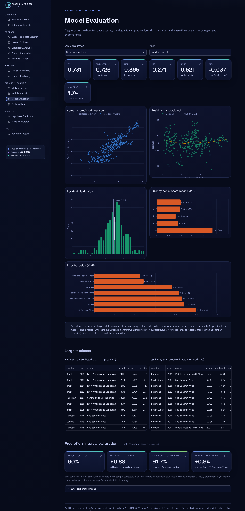</a></td>
  </tr>
  <tr>
    <td align="center" valign="top" width="33%"><b>Explainable AI</b><br><a href="docs/screenshots/10_Explainable_AI.png">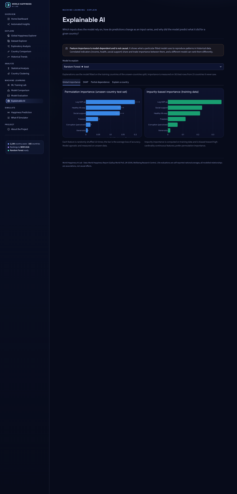</a></td>
    <td align="center" valign="top" width="33%"><b>Happiness prediction</b><br><a href="docs/screenshots/11_Happiness_Prediction.png">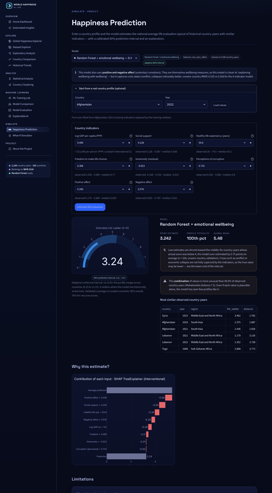</a></td>
    <td align="center" valign="top" width="33%"><b>What-if simulator</b><br><a href="docs/screenshots/12_What_If_Simulator.png">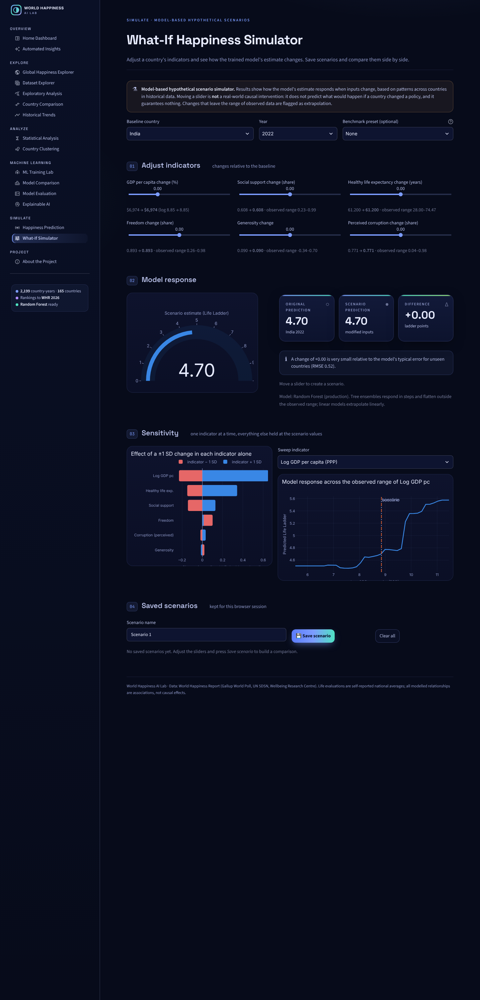</a></td>
  </tr>
  <tr>
    <td align="center" valign="top" width="33%"><b>Automated insights</b><br><a href="docs/screenshots/13_Automated_Insights.png">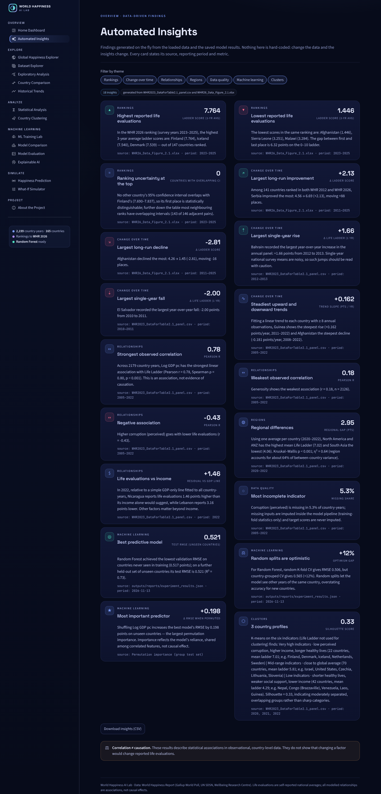</a></td>
    <td align="center" valign="top" width="33%"><b>Dataset explorer</b><br><a href="docs/screenshots/14_Dataset_Explorer.png">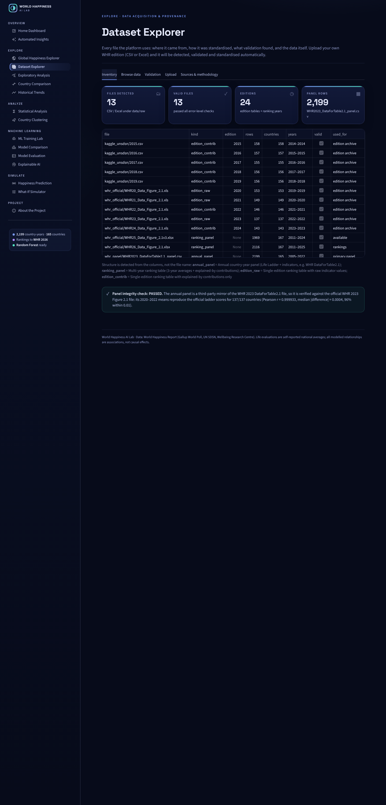</a></td>
    <td align="center" valign="top" width="33%"><b>ML training lab</b><br><a href="docs/screenshots/15_Machine_Learning_Training.png">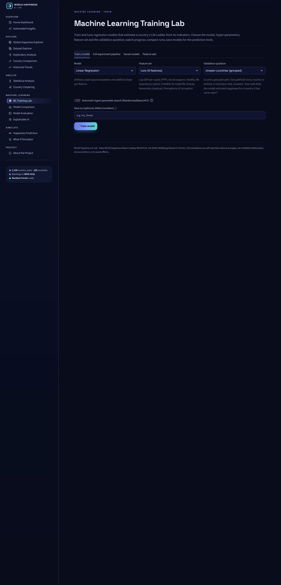</a></td>
  </tr>
</table>

---

## Contents
1. [Research questions](#1-research-questions) · 2. [Datasets](#2-datasets) · 3. [Data definitions](#3-data-definitions) ·
4. [Technologies](#4-technologies) · 5. [Exploratory analysis](#5-exploratory-analysis) · 6. [Statistical methodology](#6-statistical-methodology) ·
7. [Machine-learning methodology](#7-machine-learning-methodology) · 8. [Clustering](#8-clustering-methodology) · 9. [Evaluation metrics](#9-evaluation-metrics) ·
10. [Validation methodology](#10-validation-methodology) · 11. [Explainable AI](#11-explainable-ai) · 12. [Architecture](#12-project-architecture) ·
13. [Installation (Windows)](#13-installation-windows) · 14. [Dataset setup](#14-dataset-setup) · 15. [Run the app](#15-run-the-application) ·
16. [Train models](#16-train-models) · 17. [Prediction](#17-using-happiness-prediction) · 18. [What-if simulator](#18-using-the-what-if-simulator) ·
19. [Tests](#19-automated-tests) · 20. [Results snapshot](#20-results-snapshot) · 21. [Limitations](#21-limitations) · 22. [Future work](#22-future-improvements) · 23. [License](#23-license)

---

## 1. Research questions
| # | Question | Where it is answered |
|---|---|---|
| 1 | Are countries with higher GDP per capita generally happier? | EDA → Economic; Statistical Analysis |
| 2 | How does social support relate to happiness? | EDA → Social; Statistical Analysis |
| 3 | Does healthy life expectancy relate to happiness? | EDA; Regression; XAI |
| 4 | How important is freedom to make life choices? | Regression; Explainable AI |
| 5 | How does perceived corruption relate to reported happiness? | Correlation tests; Regression |
| 6 | How do generosity and social trust relate to happiness? | Correlation tests; Regression |
| 7 | Which countries improved or declined over time? | Historical Trends; Insights |
| 8 | Can ML estimate a country's happiness from its indicators? | ML Training, Model Comparison, Evaluation |
| 9 | Can countries be grouped into meaningful profiles? | Country Clustering |
| 10 | Which variables are most useful for prediction? | Explainable AI |

## 2. Datasets
All files live in `data/raw/` with SHA-256 checksums and methodology notes in `data/raw/sources_manifest.json`.

| Dataset | Content | Role |
|---|---|---|
| **WHR 2023 *DataForTable2.1* annual panel** (2005–2022, 2,199 country-years, 165 countries) | Life Ladder, log GDP pc, social support, healthy life expectancy, freedom, generosity, perceived corruption, positive & negative affect | **Primary** dataset for EDA, statistics, ML, clustering, prediction |
| **Official WHR *Data for Figure 2.1*** — editions 2020, 2021, 2022, 2023, 2024, 2025, 2026 (<https://worldhappiness.report/data-sharing/>) | Rankings, 3-year-average ladder scores, 95% CIs, explained-by contributions; the WHR 2026 file stacks ranking years 2011–2025 | Rankings, world map, trends, edition archive |
| **Kaggle *unsdsn/world-happiness*** 2015–2019 (CC0) | Legacy edition tables | Edition archive |

**Provenance notes.** The original S3 link for the annual panel now returns HTTP 403, so it is obtained from the public
Hugging Face mirror `Slapping/Happiness`. Because it is a mirror, it is **verified on every acquisition**: its 2020–2022 means
reproduce the official WHR 2023 Figure 2.1 scores for 137/137 countries (Pearson r = 0.99993, median |Δ| = 0.0004).
The Kaggle files come from the CC0 mirror `nateraw/world-happiness`. World Bank and Our World in Data are not needed as
separate downloads: the panel's GDP series already comes from the World Bank WDI. No observation is ever synthesised.

**Different editions differ.** The loader detects seven structural variants automatically (e.g. `Ladder score` vs `Happiness score`
vs `Life evaluation (3-year average)`; raw indicators in WHR 2020/21/23 vs explained-by contributions only in WHR 2022/24/25/26;
Kaggle 2018/19 columns named *GDP per capita* that actually hold contributions — reclassified by value range).

## 3. Data definitions
| Variable | Definition |
|---|---|
| **Life Ladder** (target) | National mean answer to the Cantril ladder question (0 = worst possible life, 10 = best). |
| Log GDP per capita | Natural log of GDP per capita, PPP constant international $ (World Bank WDI). |
| Social support | Share with relatives/friends to count on in trouble (0–1). |
| Healthy life expectancy | Healthy life expectancy at birth, years (WHO-based, interpolated by WHR). |
| Freedom | Share satisfied with freedom to choose what to do with their life (0–1). |
| Generosity | Residual of donation rate regressed on log GDP pc. |
| Perceptions of corruption | Mean perceived corruption in government and business (0–1). |
| Positive / negative affect | Yesterday's laughter, enjoyment, interest / worry, sadness, anger (0–1). |
| Ladder score (rankings) | 3-year average of Life Ladder used for the official WHR ranking. |

## 4. Technologies
Python · pandas · NumPy · SciPy · scikit-learn · XGBoost · statsmodels · SHAP · Plotly · Matplotlib · Seaborn · Streamlit · joblib · pytest · nbformat.
CPU only — no GPU is required.

## 5. Exploratory analysis
Dataset overview (observations, countries, years, mean/max/min, missing, duplicates), histogram, box plots, KDE densities, ranking
distribution with CIs, year-wise violins, top/bottom 10 with explicit reporting year, regional averages, country trends, GDP and
economic-growth scatterplots with OLS and LOWESS lines, every social indicator vs Life Ladder, Pearson and Spearman heatmaps with
significance marks, missing-value tables/heatmaps/row matrix, imputation comparison and outlier analysis (flagged, never deleted).

## 6. Statistical methodology
* **Correlation tests** — Pearson (with Fisher-z 95% CI) and Spearman, p-values, n, Holm correction; cross-sectional single-year check.
* **Multiple linear regression** (statsmodels OLS) — coefficients, classical / HC3 / **country-clustered** SEs, CIs, p-values, R², adjusted R²,
  standardised βs; diagnostics: VIF, Breusch–Pagan, Jarque–Bera, Durbin–Watson, Ramsey RESET, residual and Q–Q plots.
* **Group comparisons** — on **one mean per country** (avoids pseudo-replication): one-way ANOVA, Welch ANOVA, Kruskal–Wallis, Levene,
  Shapiro; Holm-corrected pairwise Mann–Whitney and Welch t; η², ω², ε², Cohen's d, rank-biserial. Statistical and practical significance reported separately.

## 7. Machine-learning methodology
Task: regression of Life Ladder. Models: **Linear, Ridge, Lasso, Decision Tree, Random Forest, Gradient Boosting, XGBoost**.
Every model is a scikit-learn `Pipeline(ColumnTransformer → model)`; imputation (median), scaling (Standard/Robust), one-hot encoding and the
optional composite-index transformer are fitted on training folds only. Feature sets: `core` (6 WHR indicators, default),
`engineered` (+ year, region, backward-looking GDP growth) and `core_plus_affect`. Target-derived variables are blocked by
`assert_no_leakage`. Hyper-parameters are tuned with `RandomizedSearchCV` (RF: n_estimators, max_depth, min_samples_split,
min_samples_leaf, max_features; GB: n_estimators, learning_rate, max_depth, subsample; Ridge/Lasso: alpha; XGBoost and Decision Tree too).
The deployed model is chosen by **validation RMSE on unseen countries** (MAE tie-break), refitted on all data, and given a
**conformal 90% prediction interval** whose width adapts to the profile (see the results snapshot for how well it covers).
Every split also reports two naive baselines that use no indicators (training mean and region mean) for context.

## 8. Clustering methodology
Country profile = mean of the six indicators over 2020–2022 (gaps filled only from the same country's own history). Standardised
features → K-means for k = 2…8 scored by WCSS (elbow), silhouette, Davies–Bouldin and Calinski–Harabasz; k chosen by consensus rank.
Ward hierarchical clustering (dendrogram, adjusted Rand agreement), PCA (2-D map + loadings), world map of membership. Cluster
names are generated from each cluster's z-score profile; Life Ladder is used only to describe clusters, never to form them.

## 9. Evaluation metrics
R² (variance explained), adjusted R² (penalised for predictors), MAE (typical miss, ladder points), MSE, RMSE (penalises large misses),
max error and bias. Charts: actual vs predicted, residual distribution, residuals vs predicted (with LOWESS), model comparison,
CV comparison, error by region and by score range. Models are never selected on R² alone.

## 10. Validation methodology
Three explicitly different questions, each with train / validation / test sets:

| Question | Split | Tuning CV |
|---|---|---|
| Fill in a country-year for a familiar country | random 70/15/15 | KFold(5) |
| Estimate a country **never seen** in training | country-grouped (GroupShuffleSplit) | GroupKFold(5) |
| Do past patterns hold in **future years**? | train ≤ 2016, validate 2017–18, test 2019–22 | forward-in-time year folds |

A separate experiment runs every model under all three CV schemes on the same data and shows how much random K-fold flatters accuracy.

## 11. Explainable AI
Permutation importance (on unseen-country test data), impurity / coefficient importance, **SHAP** (TreeExplainer / LinearExplainer,
beeswarm + mean |SHAP|), partial-dependence plots with ICE curves, and per-country explanations (actual, predicted, error, waterfall of
contributions, factors associated with higher/lower predictions). If SHAP is unavailable the platform falls back to permutation importance
and a median-replacement attribution. Importance is model-dependent and not causal.

## 12. Project architecture
```
world-happiness-ai-lab/
├── app.py                      # entry point: theme + grouped navigation (st.navigation)
├── views/                      # 16 app pages (see note below)
│   ├── 0_Home_Dashboard.py         ├── 8_Model_Comparison.py
│   ├── 1_Global_Happiness_Explorer.py  ├── 9_Model_Evaluation.py
│   ├── 2_Dataset_Explorer.py       ├── 10_Country_Clustering.py
│   ├── 3_Exploratory_Analysis.py   ├── 11_Explainable_AI.py
│   ├── 4_Statistical_Analysis.py   ├── 12_Happiness_Prediction.py
│   ├── 5_Country_Comparison.py     ├── 13_What_If_Simulator.py
│   ├── 6_Historical_Trends.py      ├── 14_Automated_Insights.py
│   └── 7_Machine_Learning_Training.py  └── 15_About.py
├── src/
│   ├── config.py               # paths, features, labels, design tokens (reads config.yaml)
│   ├── data_acquisition.py     # source registry, downloads, checksums, panel verification
│   ├── data_loader.py          # auto-discovery, schema detection, DataBundle, uploads
│   ├── data_validation.py      # schema/range/duplicate/missing checks → ValidationReport
│   ├── data_cleaning.py        # column aliases, contribution reclassification, cleaning
│   ├── geography.py            # country-name standardisation, ISO-3, WHR regions
│   ├── preprocessing.py        # leakage-safe pipelines, imputation comparison, outliers
│   ├── feature_engineering.py  # documented engineered features, composite transformer
│   ├── eda.py · statistical_analysis.py · clustering.py
│   ├── regression_models.py    # model registry + search spaces
│   ├── train.py                # experiments, tuning, CV comparison, conformal, CLI
│   ├── evaluate.py             # metrics, residuals, forward-year splitter
│   ├── explainability.py       # permutation, SHAP, PDP/ICE, local explanations
│   ├── country_comparison.py · prediction.py · scenario_simulator.py · insight_engine.py
│   ├── visualization.py        # Plotly theme + all chart builders
│   ├── model_manager.py        # joblib persistence + JSON registry
│   ├── report.py               # generates PROJECT_REPORT.md + figures
│   └── ui.py                   # Streamlit design system & cached accessors
├── data/raw/{whr_official,whr_panel,kaggle_unsdsn,uploads}/  data/reference/countries.csv
├── models/  outputs/{figures,reports}/  notebooks/exploratory_analysis.ipynb
├── tests/  (8 files, 109 tests)   scripts/build_notebook.py
├── .github/workflows/tests.yml  # CI: runs the test suite on every push
├── config.yaml  requirements.txt  README.md  PROJECT_REPORT.md  LICENSE
```
**Why `views/` instead of `pages/`?** Streamlit treats a folder named `pages/` as legacy auto-discovered pages: opening a page URL
directly would run that page *without* `app.py` (no theme, no grouped navigation). Using `views/` with `st.navigation` guarantees
every page always goes through the entry point.

## 13. Installation (Windows)
Requires Python **3.12 or newer** (64-bit; 3.12 and 3.13 are tested — the pinned numpy, SciPy, XGBoost and SHAP versions do not support 3.11) from <https://www.python.org/downloads/>. In **PowerShell** or **Command Prompt**:

```bash
cd path\to\world-happiness-ai-lab
```
```bash
python -m venv .venv
```
```bash
.venv\Scripts\activate
```
```bash
python -m pip install --upgrade pip
```
```bash
pip install -r requirements.txt
```
(Developer extras for rebuilding the notebook: `pip install -r requirements-dev.txt`.) (macOS/Linux: `source .venv/bin/activate`.) If PowerShell blocks activation, run `Set-ExecutionPolicy -Scope CurrentUser RemoteSigned` once.

## 14. Dataset setup
The datasets are already included in `data/raw/`. To re-download and re-verify them:
```bash
python -m src.data_acquisition
```
`--offline` only re-checksums local files; `--force` re-downloads everything. If downloads are blocked, follow the manual instructions in
**Dataset Explorer → Sources & methodology** (or in `src/data_acquisition.py`) — download the WHR *Data for Figure 2.1* files and the panel
into the listed folders, or upload CSV/Excel files in **Dataset Explorer → Upload**.

## 15. Run the application
```bash
streamlit run app.py
```
The browser opens at <http://localhost:8501>. On the very first launch (or after a library upgrade) the app trains its models
automatically with a compact search (≈1–3 minutes on a laptop CPU); afterwards everything loads from `models/`.

## 15b. Deploy with a public URL (Streamlit Community Cloud — free)
1. Sign in at <https://share.streamlit.io> with the GitHub account that owns this repository.
2. Click **Create app → Deploy a public app from GitHub**.
3. Repository: `aarushagrawal267-maker/world-happiness-ai-lab`, branch: the branch containing this code, main file path: `app.py`.
4. Under **Advanced settings** choose Python **3.12**, then **Deploy**.

The first build installs `requirements.txt` (a few minutes). Trained models are committed in `models/` and the library versions are pinned to match,
so the app opens immediately without retraining; if versions ever differ, it retrains itself automatically (≈2–5 min on the free tier).
You get a URL like `https://<your-app-name>.streamlit.app`. Every push to the branch redeploys the app.

## 16. Train models
```bash
python -m src.train
```
Full run: all 7 models × 3 validation questions with 20-iteration randomized search, CV-strategy, feature-set and imputation comparisons,
conformal calibration, production refits (≈3–6 minutes on 4 cores). Options: `--quick` (8 iterations), `--no-tune`,
`--models ridge random_forest`, `--feature-set engineered`. Then regenerate the report:
```bash
python -m src.report
```
In the app, **ML Training Lab** lets you pick a model, hyper-parameters, feature set and validation question, watch progress, compare runs and save models.

## 17. Using Happiness Prediction
Open **Happiness Prediction**, optionally load a real country's profile, edit the six indicators (inputs are validated against definitional
limits and the training range; GDP is shown in dollars as well as logs) and press *Estimate*. You get the estimate, the model used, an
adaptive 90% conformal interval (for the two ★ recommended models; the other models give a point estimate only), extrapolation warnings (per input and for the combination via Mahalanobis distance), the most similar observed
country-years, a contribution waterfall, global importance and the model's limitations.

## 18. Using the What-If Simulator
Pick a baseline country/year (or the global median), move the sliders (GDP in %, others in natural units) or copy indicators from a benchmark
country. The page shows the original and modified predictions, the difference, the indicator changes, a tornado sensitivity chart and a sweep
curve. Save scenarios to compare them side by side and download them as CSV. This is a **model-based hypothetical scenario simulator** — not a
causal forecast; extrapolation beyond the observed data is flagged.

## 19. Automated tests
```bash
python -m pytest -q
```
109 tests cover loading, validation, country-name standardisation, missing values, feature engineering, statistics, every model,
splits without leakage, clustering, predictions and ranges, scenarios, map data preparation, visualisation inputs, insights and persistence.
The same suite runs automatically on GitHub Actions for every push and pull request (`.github/workflows/tests.yml`).

## 20. Results snapshot
From the training run of 2026-11-14 (full details, tables and figures in [`PROJECT_REPORT.md`](PROJECT_REPORT.md); numbers change slightly if you retrain with different library versions).

**Data:** 2,199 country-years · 165 countries · 2005–2022 panel; official rankings to WHR 2026 (147 countries, survey years 2023–2025 — highest Finland 7.764, lowest Afghanistan 1.446).

**Statistics:** strongest correlate log GDP per capita (r = 0.78, n = 2,179); the six indicators give pooled OLS R² = 0.753 (n = 1,962, 156 countries); all six remain significant with country-clustered SEs (generosity p = 0.027).

**Test RMSE (ladder points) by validation question**

| Model | Random split | Unseen countries | Future years |
|---|---|---|---|
| Linear Regression | 0.606 | 0.573 | 0.564 |
| Ridge | 0.606 | 0.571 | 0.564 |
| Lasso | 0.606 | 0.573 | 0.564 |
| Decision Tree | 0.570 | 0.636 | 0.658 |
| **Random Forest** (selected) | 0.488 | **0.521** | 0.568 |
| Gradient Boosting | 0.503 | 0.537 | 0.578 |
| XGBoost | 0.489 | 0.517 | 0.569 |
| *Baseline: training mean* | 1.115 | 1.011 | 1.145 |
| *Baseline: region mean* | 0.719 | 0.687 | 0.797 |

* Random Forest was selected on validation RMSE for unseen countries (0.517): test R² 0.731, MAE 0.395 on 25 held-out countries.
  Knowing only a country's region already gives RMSE 0.687 on those countries; the six indicators cut that error by about a quarter.
  The 25 test countries are a single draw: resampling whole countries gives a 95% interval of 0.40–0.65 for that RMSE, and the
  Random Forest − XGBoost (−0.03 to +0.04) and Random Forest − Ridge (−0.12 to +0.02) differences both include 0, so this test set does not prove the forest beats a linear model on new countries.
* 5-fold CV: random K-fold RMSE 0.506 vs country-grouped 0.565 for Random Forest — random splits look ~12% better than reality for new countries.
* Feature engineering (year + region + GDP growth) lowers grouped CV RMSE from 0.565 to 0.545 (Random Forest).
* **Prediction intervals.** A fixed-width split-conformal interval (±0.88, calibrated on validation countries) covered 91.7% of rows from the 25 unseen test countries.
  The app uses an **adaptive 90% interval** (normalised conformal with a learned difficulty model), width ±0.29 to ±2.14 depending on the profile.
  Its 90.0% overall coverage on the out-of-fold rows used to calibrate it holds by construction; on those rows it covers 75% of very unhappy country-years (fixed-width: 68%).
  In a held-out check (interval refitted without the 25 test countries) it covered 92.7% overall but only 57% of the 21 test rows below 4 (fixed-width: 52%), so intervals for very unhappy countries are too narrow.
* **Extremes:** like any imperfect model, predictions shrink toward the middle (actual < 4 over-estimated by ~0.78 on unseen countries). The app shows the measured bias as a warning and offers a companion model with positive/negative affect (grouped out-of-fold RMSE 0.535 vs 0.568) that captures crisis states better.
* Permutation importance: log GDP > healthy life expectancy ≈ social support > freedom > corruption > generosity.
* Clustering: k = 3 (silhouette 0.33) — very high-indicator / mid-range / low-indicator country profiles.

## 21. Limitations
* Reported life evaluations can be affected by cultural response styles.
* Observational data: confounding and reverse causality are possible; nothing here is causal.
* Country-years are not independent; naïve p-values are too small (clustered SEs provided).
* National means rely on ~1,000 respondents per year; small changes are within sampling error.
* The public annual panel ends in 2022. WHR 2024–2026 rankings are included but contain explained-by contributions, not raw indicators.
* Coverage varies by year and some indicators are missing for some countries.
* Positive/negative affect are excluded from the default model because they are themselves wellbeing measures.
* What-if results describe model behaviour and are unreliable outside the observed data range.
* The 90% intervals hold on average, not for every country: they under-cover very unhappy country-years (see the results snapshot).
* Hyper-parameters tuned on the grouped split's training countries are reused in the all-data experiments (CV-scheme comparison, out-of-fold intervals), so those figures are slightly optimistic.
* Each validation question uses one fixed split (e.g. 25 unseen test countries), so test metrics are noisy: the selected model's unseen-country RMSE has a 95% country-bootstrap interval of 0.40–0.65 (see `PROJECT_REPORT.md` §6.4).

## 22. Future improvements
* Add the WHR 2024–2026 annual panels when they become publicly downloadable.
* Hierarchical / mixed-effects models (country random effects) and panel fixed-effects regressions.
* Additional covariates from World Bank / OWID (inequality, unemployment, conflict) with explicit provenance.
* Quantile regression forests or conformalised quantile regression for heteroscedastic intervals.
* Population-weighted global and regional aggregates.
* Exportable PDF report from the app.

## 23. License
Code: MIT License (see [`LICENSE`](LICENSE)). The datasets in `data/raw/` keep their original terms: World Happiness Report data
is published by the WHR editors for research and education (cite the report), and the Kaggle *unsdsn/world-happiness* files are CC0.

---
*Data: World Happiness Report (Helliwell, Layard, Sachs, De Neve, Aknin, Wang, eds.), Gallup World Poll, UN SDSN, Wellbeing Research Centre (Oxford).*
